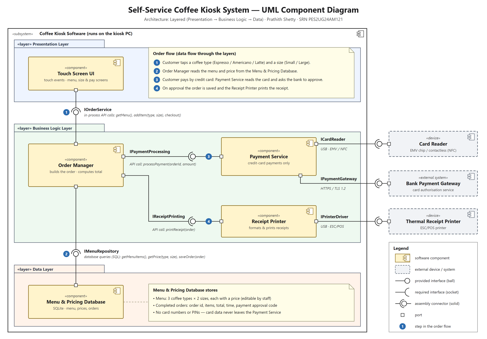

# Lab 3 – Component Modelling & Architectural Pattern Selection

**Name:** Prathith Shetty  **SRN:** PES2UG24AM121
**Scenario:** Self-Service Coffee Kiosk System
**Chosen architecture:** Layered (Presentation → Business Logic → Data)

## Deliverables

| Deliverable | File |
|---|---|
| UML component diagram (PNG) | [Lab3_Component_Diagram.png](Lab3_Component_Diagram.png) |
| UML component diagram (PDF) | [Lab3_Component_Diagram.pdf](Lab3_Component_Diagram.pdf) |
| Diagram source (SVG) | [Lab3_Component_Diagram.svg](Lab3_Component_Diagram.svg) |
| Written justification (Word) | [Lab3_Architecture_Justification.docx](Lab3_Architecture_Justification.docx) |
| Written justification (PDF) | [Lab3_Architecture_Justification.pdf](Lab3_Architecture_Justification.pdf) |

## Components

| Layer | Component | Role |
|---|---|---|
| Presentation | Touch Screen UI | Touch screens for coffee type, size and payment |
| Business Logic | Order Manager | Builds the order and computes the total |
| Business Logic | Payment Service | Credit-card payments (card reader + bank gateway) |
| Business Logic | Receipt Printer | Formats and prints receipts |
| Data | Menu & Pricing Database | Menu, sizes, prices and completed orders |

External: Card Reader «device», Bank Payment Gateway «external system», Thermal Receipt Printer «device».

## Interfaces

| Interface | Provided by | Required by | Technology |
|---|---|---|---|
| IOrderService | Order Manager | Touch Screen UI | In-process API calls |
| IPaymentProcessing | Payment Service | Order Manager | API call (payment requests) |
| IReceiptPrinting | Receipt Printer | Order Manager | API call |
| IMenuRepository | Menu & Pricing Database | Order Manager | Database queries (SQL) |
| ICardReader | Card Reader | Payment Service | Hardware: USB, EMV/NFC |
| IPaymentGateway | Bank Payment Gateway | Payment Service | HTTPS / TLS 1.2 |
| IPrinterDriver | Thermal Receipt Printer | Receipt Printer | Hardware: USB, ESC/POS |
